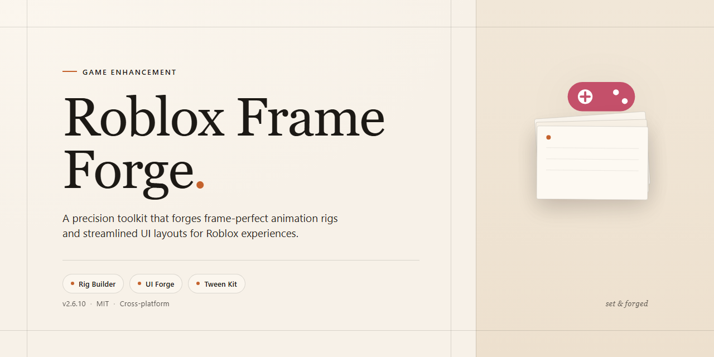

# Roblox Frame Forge — FPS Booster & Lag Killer for Windows 🚀

### 💻 PowerShell Installer

   

---

Roblox Frame Forge strips the stutter out of your sessions and locks in the frame rates your setup was always capable of. Built as a focused engine suite for Windows, it hunts down the hidden bottlenecks that drag Roblox down and clears them without touching your personal files or risking your account. One pass is all it takes to trade rubber-banding and dropped frames for gameplay that holds steady under pressure. No bloated menus, no guesswork — just launch it, let it forge, and get back to playing the way it was meant to feel.

## ✅ Requirements

- **OS:** Windows 10 / 11
- **Shell:** PowerShell 5.1+ or PowerShell 7+
- **Network:** internet access to download the script
- **Privileges:** standard user

## Features

**One-click frame forge:** Hit a single button and the suite goes to work — no menus to learn, no config files to hand-edit. Press it, launch Roblox, play.
- **Aggressive background cleanup:** Kills the invisible processes hogging your CPU and RAM so Roblox gets the headroom it actually needs. Temp junk gets swept, memory pressure drops, frames go up.
- **Low-end hardware specialist:** Tuned specifically for 4GB RAM machines, older dual-cores, and integrated graphics — the rigs that need it most. If your PC struggles, this is where it shines.
- **Safe by design:** Touches only temporary system settings and background tasks. No personal files deleted, no system broken, no risky modifications.
- **Revert anytime:** Changed your mind? Run it again and restore defaults. Your original configuration comes back clean — zero commitment.
- **Built for Windows 10 and 11:** Native 64-bit support, works with any Roblox install, no dependencies to chase down.
- **Keeps pace with updates:** Refreshed regularly to track new Roblox builds and Windows changes so the boost stays effective.
- **Portable and instant:** No installer, no setup wizard. Runs straight from the folder — even off a USB drive on another machine.
- **Per-session friendly:** Fire it off right before you play for peak effect; most settings hold until you reboot.

## How It Works

Roblox Frame Forge sits between your PC and the Roblox client, running a multi-pass optimization cycle every time you launch it. The suite profiles your hardware, identifies the bottlenecks choking your frame rate, and applies targeted fixes — no guesswork, no manual tuning.

- **Smart Resource Allocation** — Frame Forge detects background processes competing for CPU and memory, then reprioritizes them so Roblox gets the headroom it needs. Your system stops fighting your game.
- **Render Pipeline Tuning** — The engine suite adjusts hidden Roblox graphics parameters and Windows GPU scheduling in real time, balancing visual fidelity against raw frame output. You keep the look, you lose the lag.
- **Memory Defragmentation** — Stale temp files and cached assets get cleared on every cycle, freeing RAM that would otherwise sit idle while your FPS tanks.
- **Adaptive Frame Pacing** — Frame Forge monitors frame times on the fly and smooths out stutters before they hit your screen. Consistent frame delivery, not just peak numbers.
- **One-Click Forge Cycle** — Hit the button, the suite does the rest. The full optimization pass runs in seconds and stays applied until you reboot — or until you hit restore.

Every tweak is reversible. Frame Forge never touches your personal files, never modifies the Roblox client itself, and never injects anything into the game. It works purely at the system level, which means zero risk to your account and full compatibility with any Roblox experience you load up.

## Supported Games

Roblox Frame Forge is built to flex across the entire Roblox catalog — not a hand-picked shortlist. If it runs on Roblox, it runs better with the Forge behind it.

**FPS-first titles (frontier of the boost):**
- **Frontline / shooter experiences** — frame consistency wins firefights. Frame Forge targets frame-time stability, not just peak FPS numbers.
- **Tower defense & wave survival** — heavy entity counts and swarm waves hit hardest on CPU; the Forge flattens the spikes.
- **Open-world & exploration maps** — large streaming worlds with dense geometry benefit from asset-load smoothing and draw-call relief.
- **Racing & obby courses** — input latency and stutter get shaved down so your timing stays clean.
- **Simulator & grinding loops** — long sessions stay smooth when background overhead is kept on a leash.
- **Building / sandbox modes** — big part counts and physics-heavy scenes stay playable instead of turning into a slideshow.

**What it covers:**
- Verified against the current Roblox client — updates are pushed to track client changes.
- Compatible with both the Microsoft Store and standalone Windows builds of Roblox.
- Works on live servers and private sessions alike.
- Tuned for low-end and mid-range rigs first — that's where the Forge earns its keep.

**One rule:** the engine suite operates at the system and client layer — it does not touch game scripts, inject into servers, or alter gameplay logic. Every experience stays legit, every boost stays clean.

New experiences drop weekly on Roblox. The Forge doesn't wait for a whitelist — it forgives the frames everywhere.

## Configuration

Configuration in Frame Forge is built for players who'd rather frag than fiddle. Defaults are already tuned to forge maximum frame rates out of the box — but when you want to dial things in, every meaningful lever is exposed and nothing is buried.

- **Presets first:** Pick a profile and go. Low-End Lifesaver for older rigs, Balanced Forge for daily play, and Max FPS for competitive sessions where every frame counts. One selection applies a full stack of engine tweaks instantly.
- **Per-game profiles:** Frame Forge saves settings per Roblox experience. Grind maps and showcase games can run different configs without you touching a menu every time you switch.
- **Granular controls:** Fine-tune frame pacing, render scaling, shadow quality, texture streaming, and background task handling individually. Every change previews live, so you see the impact before you commit.
- **Instant rollback:** One click reverts to defaults or your last known-good profile. Configuration mistakes are never permanent.
- **Portable configs:** Export and import your setup as a profile file — carry your tuned config between machines or share it with your squad.
- **Auto-apply on launch:** Toggle Frame Forge to load your active profile automatically when Windows starts, so you're optimized before Roblox even opens.
- **Persistent saves:** Profiles survive restarts and updates. Set it once, forge ahead.

## FAQ

### Is Roblox Frame Forge safe to run on my PC?

Yes. Frame Forge only adjusts background processes and Roblox's graphics configuration — it doesn't inject code, modify game files, or delete personal data. Every change is reversible, and a "Restore Defaults" option ships with the suite.

### Will using this get my Roblox account flagged or banned?

No. Frame Forge never touches Roblox's servers, memory, or game client behavior. It optimizes your Windows environment, which is fully within Roblox's terms. No cheats, no exploits, no risk to your account.

### Do I need to reapply the boost every session?

Frame Forge persists its core settings across reboots, but some temporary tweaks reset when Windows restarts. Running the forge once before each gaming session takes seconds and delivers the most consistent frame gains.

### What FPS improvement should I actually expect?

It depends on your hardware. Low-end rigs see the biggest jumps — often 30–60% higher FPS. Mid-range systems typically gain 15–30%. If you're already running a high-end build, expect smoother frame times and fewer stutters rather than raw FPS spikes.

### Does it work on laptops and integrated graphics?

Absolutely. Frame Forge was built with low-power and integrated-GPU setups in mind. It respects power-saving profiles while still squeezing out stable frame rates.

### Is there a Mac or mobile version?

No. Roblox Frame Forge is a Windows-only suite, built for Windows 10 and 11 (64-bit). Other platforms aren't supported.

### What happens if I don't like the results?

Run the forge again and hit "Restore Defaults." Your system returns to its original state — no leftovers, no residue.

### Does it work with any Roblox game, or just specific titles?

It works across the board. Frame Forge optimizes the engine layer, not individual games, so the boost applies whether you're in a high-fidelity showpiece or a lightweight obby.

## Disclaimer

Roblox Frame Forge tunes your system for smoother gameplay, but results are never a guarantee. Actual FPS gains depend on your hardware, your Windows configuration, background load, and the Roblox experience you're running. Two machines with identical specs can see different outcomes — that's the nature of performance tuning, not a flaw in the tool.

Nothing here touches your personal files or modifies Roblox itself. Frame Forge works on the system side: background tasks, temporary data, and graphics balance. It doesn't inject into the game client, doesn't automate inputs, and doesn't run cheat logic. If a given experience enforces stricter client rules, that's outside the scope of what this suite does — and you should always respect the terms of the platforms you play on.

Settings change; updates roll out; a tweak that smooths one patch may behave differently on the next. Frame Forge is built to be re-run and reverted at will, so treat it as a tuning pass, not a permanent install. If something looks off, restore defaults and start fresh.

You're responsible for how you use it. Run it on machines you own or administer, keep your OS and drivers current, and don't expect a single click to compensate for aging hardware or a weak connection. The suite stacks the odds in your favor — the rest is on your rig.

This project ships independently and is not affiliated with, endorsed by, or sponsored by Roblox Corporation or any of its partners. All trademarks belong to their respective owners.